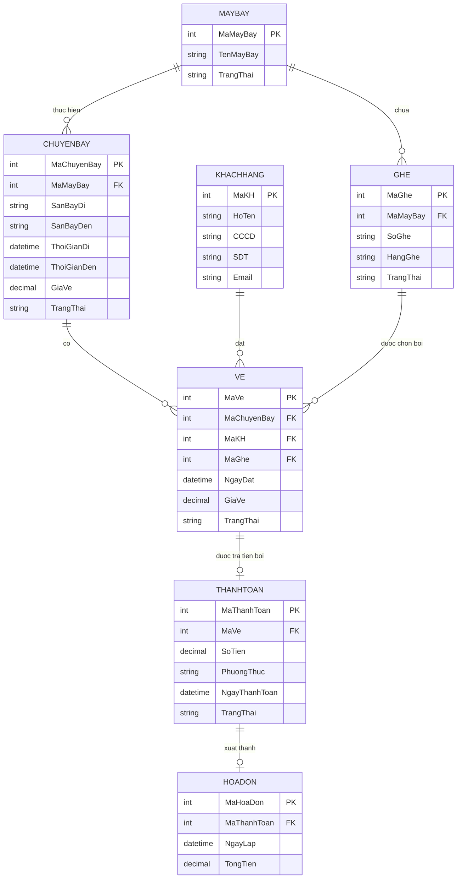
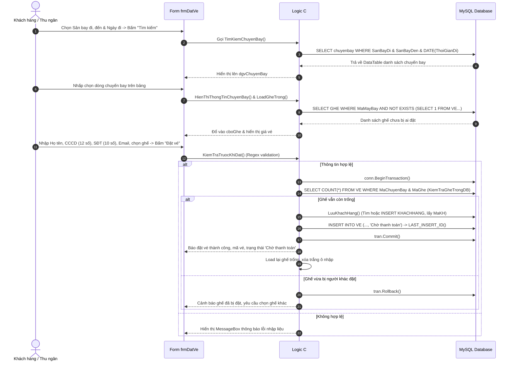
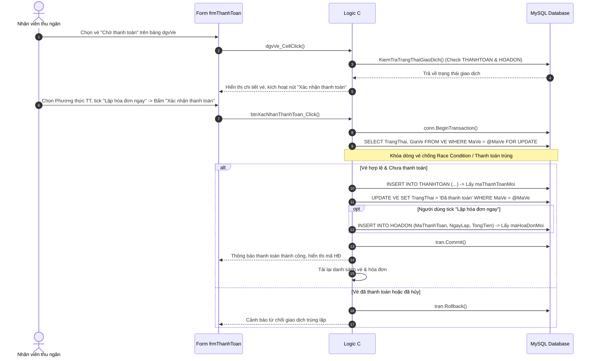
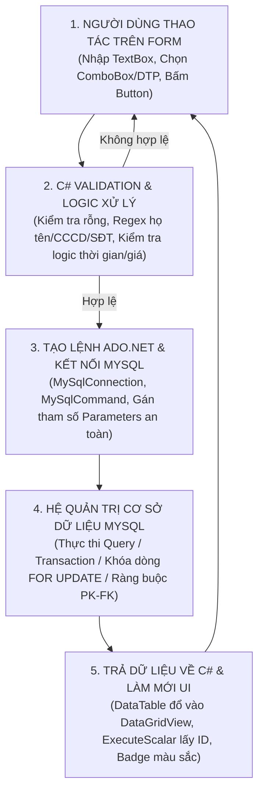

# TÀI LIỆU TOÀN DIỆN DỰ ÁN QUẢN LÝ ĐẶT VÉ MÁY BAY
> **Ngôn ngữ & Nền tảng:** C# WinForms (.NET 10.0 Windows)  
> **Cơ sở dữ liệu:** MySQL Database (`QuanLyDatVeMayBay`) qua thư viện `MySql.Data`  
> **Mục tiêu tài liệu:** Giúp sinh viên nắm chắc kiến thức lập trình thực tế trong dự án, hiểu sâu bản chất từng dòng lệnh, tự tin bảo vệ đồ án trước giảng viên.

---

## MỤC LỤC

1. [Tổng quan kiến trúc & Cấu trúc mã nguồn](#1-tổng-quan-kiến-trúc--cấu-trúc-mã-nguồn)
2. [Cơ sở dữ liệu & Mô hình thực thể quan hệ (ERD)](#2-cơ-sở-dữ-liệu--mô-hình-thực-thể-quan-hệ-erd)
3. [Nghiệp vụ chi tiết theo 3 giai đoạn](#3-nghiệp-vụ-chi-tiết-theo-3-giai-đoạn)
   - [Giai đoạn 1: Quản lý chuyến bay (`Form1.cs`)](#giai-đoạn-1-quản-lý-chuyến-bay-form1cs)
   - [Giai đoạn 2: Đặt vé máy bay (`frmDatVe.cs`)](#giai-đoạn-2-đặt-vé-máy-bay-frmdatvecs)
   - [Giai đoạn 3: Thanh toán và Hóa đơn (`frmThanhToan.cs`)](#giai-đoạn-3-thanh-toán-và-hóa-đơn-frmthanhtoancs)
4. [Luồng dữ liệu tổng quát (End-to-End Data Flow)](#4-luồng-dữ-liệu-tổng-quát-end-to-end-data-flow)
5. [Tổng hợp kiến thức lập trình thực tế có trong dự án](#5-tổng-hợp-kiến-thức-lập-trình-thực-tế-có-trong-dự-án)
   - [5.1. C# Cơ bản & Nâng cao](#51-c-cơ-bản--nâng-cao)
   - [5.2. Windows Forms Controls & Events](#52-windows-forms-controls--events)
   - [5.3. MySQL & ADO.NET](#53-mysql--adonet)
   - [5.4. Các câu lệnh SQL thực tế](#54-các-câu-lệnh-sql-thực-tế)
6. [Mổ xẻ chi tiết từng dòng các đoạn code trọng yếu](#6-mổ-xẻ-chi-tiết-từng-dòng-các-đoạn-code-trọng-yếu)
   - [Đoạn 1: Thêm chuyến bay (`btnThem_Click` - `Form1.cs`)](#đoạn-1-thêm-chuyến-bay-btnthem_click---form1cs)
   - [Đoạn 2: Nạp ghế trống chuyến bay (`LoadGheTrong` - `frmDatVe.cs`)](#đoạn-2-nạp-ghế-trống-chuyến-bay-loadghetrong---frmdatvecs)
   - [Đoạn 3: Đặt vé có Transaction (`TaoVe` - `frmDatVe.cs`)](#đoạn-3-đặt-vé-có-transaction-taove---frmdatvecs)
   - [Đoạn 4: Xác nhận thanh toán & Khóa dòng FOR UPDATE (`btnXacNhanThanhToan_Click` - `frmThanhToan.cs`)](#đoạn-4-xác-nhận-thanh-toán--khóa-dòng-for-update-btnxacnhanthanhtoan_click---frmthanhtoancs)
   - [Đoạn 5: Lập hóa đơn & Đọc số tiền thành chữ (`btnLapHoaDon_Click` & `DocTienBangChu` - `frmThanhToan.cs`)](#đoạn-5-lập-hóa-đơn--đọc-số-tiền-thành-chữ-btnlaphoadon_click--doctienbangchu---frmthanhtoancs)
7. [Bảng tra cứu nhanh câu lệnh & khái niệm (Cheat Sheet)](#7-bảng-tra-cứu-nhanh-câu-lệnh--khái-niệm-cheat-sheet)
8. [20 câu hỏi tự ôn tập & vấn đáp bảo vệ đồ án (Kèm đáp án)](#8-20-câu-hỏi-tự-ôn-tập--vấn-đáp-bảo-vệ-đồ-án-kèm-đáp-án)
9. [Những điểm cần lưu ý & phần chưa có trong mã nguồn](#9-những-điểm-cần-lưu-ý--phần-chưa-có-trong-mã-nguồn)

---

## 1. TỔNG QUAN KIẾN TRÚC & CẤU TRÚC MÃ NGUỒN

Dự án sử dụng mô hình ứng dụng máy tính **C# Windows Forms** chạy trên nền **.NET 10.0 Windows**, kết nối trực tiếp với hệ quản trị cơ sở dữ liệu **MySQL** thông qua nhà cung cấp dữ liệu chính thức `MySql.Data` (phiên bản 26.7.0).

### Cấu trúc thư mục dự án

```text
QuanLyVeMayBay/
│
├── Dal/
│   └── Database.cs                 # Lớp quản lý chuỗi kết nối và cấp phát MySqlConnection
│
├── Form1.cs                        # GIAI ĐOẠN 1: Quản lý danh mục chuyến bay (CRUD Chuyến bay)
├── Form1.Designer.cs               # Mã thiết kế giao diện Form1 sinh tự động bởi Visual Studio
├── Form1.resx                      # Tài nguyên giao diện Form1
│
├── frmDatVe.cs                     # GIAI ĐOẠN 2: Tra cứu chuyến bay, chọn ghế và đặt vé
├── frmDatVe.Designer.cs            # Mã thiết kế giao diện đặt vé
├── frmDatVe.resx                   # Tài nguyên giao diện đặt vé
│
├── frmThanhToan.cs                 # GIAI ĐOẠN 3: Xác nhận thanh toán vé, quản lý và in hóa đơn
├── frmThanhToan.Designer.cs        # Mã thiết kế giao diện thanh toán & hóa đơn
├── frmThanhToan.resx               # Tài nguyên giao diện thanh toán
│
├── UiTheme.cs                      # Lớp tiện ích tĩnh định nghĩa bảng màu, font chữ, style giao diện
├── Program.cs                      # Điểm khởi chạy ứng dụng (hàm Main, khởi tạo Form1)
├── QuanLyVeMayBay.csproj           # Cấu hình dự án .NET 10, WindowsForms, MySql.Data
└── App.config                      # Cấu hình runtime cơ bản
```

### Danh sách các Class chính trong mã nguồn

1. **`QuanLyVeMayBay.DAL.Database`** (trong [Database.cs](file:///c:/Users/pc/source/repos/QuanLyVeMayBay/Dal/Database.cs)):
   - Biến thành viên: `private string connectionString = "Server=localhost;Port=3306;Database=QuanLyDatVeMayBay;Uid=root;Pwd=123456;";`
   - Phương thức: `public MySqlConnection GetConnection()`: Khởi tạo và trả về đối tượng kết nối `MySqlConnection`.
2. **`QuanLyVeMayBay.Program`** (trong [Program.cs](file:///c:/Users/pc/source/repos/QuanLyVeMayBay/Program.cs)):
   - Chứa phương thức `static void Main()`: Điểm nhập cuộc (Entry point) khởi chạy ứng dụng, mở `Form1`.
3. **`QuanLyVeMayBay.Form1`** (trong [Form1.cs](file:///c:/Users/pc/source/repos/QuanLyVeMayBay/Form1.cs)):
   - Kế thừa từ `System.Windows.Forms.Form`.
   - Đảm nhiệm giao diện quản lý chuyến bay (Thêm, Sửa, Xóa, Làm mới, Lọc sân bay, Tự cập nhật trạng thái chuyến bay).
4. **`QuanLyVeMayBay.frmDatVe`** (trong [frmDatVe.cs](file:///c:/Users/pc/source/repos/QuanLyVeMayBay/frmDatVe.cs)):
   - Kế thừa từ `System.Windows.Forms.Form`.
   - Đảm nhiệm tìm kiếm chuyến bay theo ngày & chặng bay, tự động seed ghế mẫu nếu rỗng, kiểm tra ghế trống, kiểm tra định dạng khách hàng bằng Regex, lưu khách hàng và tạo vé (`TrangThai = 'Chờ thanh toán'`).
5. **`QuanLyVeMayBay.frmThanhToan`** (trong [frmThanhToan.cs](file:///c:/Users/pc/source/repos/QuanLyVeMayBay/frmThanhToan.cs)):
   - Kế thừa từ `System.Windows.Forms.Form`.
   - Đảm nhiệm xác nhận thanh toán vé với khóa dòng `FOR UPDATE`, ghi nhận thanh toán vào bảng `THANHTOAN`, chuyển trạng thái `VE` thành `'Đã thanh toán'`, lập hóa đơn vào bảng `HOADON`, tra cứu hóa đơn đa tiêu chí, định dạng mẫu hóa đơn điện tử và in ấn modal.
6. **`QuanLyVeMayBay.UiTheme`** (trong [UiTheme.cs](file:///c:/Users/pc/source/repos/QuanLyVeMayBay/UiTheme.cs)):
   - Lớp `public static class UiTheme`: Chuẩn hóa màu sắc (Ocean Blue, Emerald, Amber, Rose, Slate), font chữ (Segoe UI), bo viền giao diện, định dạng DataGridView và tô màu Badge trạng thái tự động (`FormatStatusCell`).

---

## 2. CƠ SỞ DỮ LIỆU & MÔ HÌNH THỰC THỂ QUAN HỆ (ERD)

Cơ sở dữ liệu mang tên **`QuanLyDatVeMayBay`** gồm **7 bảng** có mối quan hệ chặt chẽ với nhau:



### Chi tiết các bảng và ý nghĩa:

1. **`MAYBAY`**: Lưu trữ danh sách tàu bay của hãng (`MaMayBay`, `TenMayBay`, `TrangThai`).
2. **`CHUYENBAY`**: Lịch trình bay (`MaChuyenBay`, `MaMayBay`, `SanBayDi`, `SanBayDen`, `ThoiGianDi`, `ThoiGianDen`, `GiaVe`, `TrangThai`). Khóa ngoại `MaMayBay` tham chiếu đến bảng `MAYBAY`.
3. **`GHE`**: Ghế ngồi vật lý trên từng máy bay (`MaGhe`, `MaMayBay`, `SoGhe`, `HangGhe`, `TrangThai`). Khóa ngoại `MaMayBay` tham chiếu đến bảng `MAYBAY`.
4. **`KHACHHANG`**: Thông tin hành khách (`MaKH`, `HoTen`, `CCCD`, `SDT`, `Email`).
5. **`VE`**: Bản ghi đặt chỗ (`MaVe`, `MaChuyenBay`, `MaKH`, `MaGhe`, `NgayDat`, `GiaVe`, `TrangThai`). Khóa ngoại liên kết tới `CHUYENBAY`, `KHACHHANG`, `GHE`.
6. **`THANHTOAN`**: Giao dịch thanh toán tiền vé (`MaThanhToan`, `MaVe`, `SoTien`, `PhuongThuc`, `NgayThanhToan`, `TrangThai`). Khóa ngoại tham chiếu `VE`.
7. **`HOADON`**: Chứng từ kế toán/hóa đơn tài chính (`MaHoaDon`, `MaThanhToan`, `NgayLap`, `TongTien`). Khóa ngoại tham chiếu `THANHTOAN`.

---

## 3. NGHIỆP VỤ CHI TIẾT THEO 3 GIAI ĐOẠN

### Giai đoạn 1: Quản lý chuyến bay (`Form1.cs`)

- **Nạp dữ liệu ban đầu:**
  - `LoadMayBay()`: Tải các máy bay có `TrangThai = 'Hoạt động'` vào `cboMaMayBay`.
  - `LoadSanBay()`: Tải danh mục 12 sân bay chính (Nội Bài, Tân Sơn Nhất, Đà Nẵng, Cam Ranh, Phú Quốc, Cát Bi, Vân Đồn, Vinh, Phú Bài, Phù Cát, BKK, NRT) vào `cboSanBayDi` và `cboSanBayDen`.
  - `HienThiChuyenBay()`: Lấy danh sách chuyến bay từ bảng `chuyenbay` đổ vào `dgvChuyenBay`.
- **Kiểm tra nghiệp vụ (Validation) trước khi lưu:**
  - Bắt buộc chọn máy bay (`maMayBay > 0`).
  - Sân bay đi và Sân bay đến không được để trống và không được trùng nhau.
  - Thời gian đến (`dtpThoiGianDen`) bắt buộc phải sau thời gian đi (`dtpThoiGianDi`).
  - Giá vé phải là số dương lớn hơn 0.
- **Thêm chuyến bay (`btnThem_Click`):** Thực thi câu lệnh `INSERT INTO chuyenbay`. Bắt lỗi MySQL `1452` (máy bay không tồn tại) và `1062` (trùng mã).
- **Sửa chuyến bay (`btnSua_Click`):** Thực thi câu lệnh `UPDATE chuyenbay` theo `MaChuyenBay`.
- **Xóa chuyến bay (`btnXoa_Click`):** Hỏi xác nhận `MessageBoxButtons.YesNo`. Thực thi `DELETE FROM chuyenbay`. Nếu gặp lỗi `1451` (đã có vé liên kết), chương trình cảnh báo không cho xóa để đảm bảo toàn vẹn dữ liệu.
- **Tự động cập nhật trạng thái:** `CapNhatTrangThaiChuyenBay()` tự động quét các chuyến bay có `ThoiGianDi <= NOW()` và `TrangThai = 'Đang mở'` để cập nhật thành `'Đã khởi hành'`.

---

### Giai đoạn 2: Đặt vé máy bay (`frmDatVe.cs`)



- **Tự động sinh ghế mẫu (`SeedGheMauNeuTrong`):** Nếu bảng `GHE` rỗng, hệ thống tự động tạo các ghế Thương gia (A1-D2) và Phổ thông (E1-H3) cho từng máy bay.
- **Tìm kiếm chuyến bay (`TimKiemChuyenBay`):** Tìm kiếm chuyến bay theo `SanBayDi`, `SanBayDen`, và ngày `DATE(ThoiGianDi) = @NgayDi`.
- **Lọc ghế trống thực tế (`LoadGheTrong`):** Dùng toán tử `NOT EXISTS` để loại trừ các ghế đã có người đặt trên chuyến bay đó.
- **Kiểm tra thông tin hành khách bằng Regular Expression (Regex):**
  - Họ tên: `^[\p{L}\s]+$` (chỉ cho phép chữ cái và khoảng trắng).
  - CCCD: `^\d{12}$` (đúng 12 chữ số).
  - Số điện thoại: `^\d{10}$` (đúng 10 chữ số).
  - Email: `^[^\s@]+@[^\s@]+\.[^\s@]+$` (đúng chuẩn email).
- **Lưu khách hàng thông minh (`LuuKhachHang`):** Tìm kiếm theo CCCD hoặc SĐT xem khách hàng đã tồn tại chưa. Nếu có rồi thì tái sử dụng `MaKH`, nếu chưa có thì `INSERT INTO KHACHHANG` rồi lấy `LAST_INSERT_ID()`.
- **Giao dịch đặt vé an toàn (`TaoVe`):** Dùng `MySqlTransaction` để đảm bảo:
  1. Kiểm tra lại ghế trống trong DB (`KiemTraGheTrongDB`).
  2. Lưu/Lấy khách hàng.
  3. Tạo vé mới với trạng thái `'Chờ thanh toán'`.
  4. Nếu xảy ra lỗi hoặc ghế đã bị người khác giữ trước, gọi `tran.Rollback()`.

---

### Giai đoạn 3: Thanh toán và Hóa đơn (`frmThanhToan.cs`)



- **Quản lý danh sách vé & Bộ lọc:**
  - Lọc theo trạng thái: `"Chờ thanh toán"`, `"Đã thanh toán"`, `"Tất cả vé"`.
  - Tìm kiếm tức thời khi gõ ký tự (`txtTimVe_TextChanged`) theo Mã vé, Họ tên, SĐT, Sân bay.
- **Xác nhận thanh toán an toàn:**
  - Sử dụng từ khóa `FOR UPDATE` trong câu truy vấn `SELECT TrangThai, GiaVe FROM VE WHERE MaVe = @MaVe FOR UPDATE;` nhằm khóa bản ghi vé trong suốt thời gian Transaction thực thi, loại bỏ hoàn toàn nguy cơ 2 nhân viên cùng bấm thanh toán 1 vé cùng lúc (Race Condition).
  - Kiểm tra bảng `THANHTOAN` xem đã có bản ghi thanh toán cho vé này chưa.
  - Thực thi đồng thời 3 hành động trong một Transaction:
    1. Thêm bản ghi vào `THANHTOAN` với phương thức được chọn (Tiền mặt, Chuyển khoản, Thẻ, Ví điện tử).
    2. Cập nhật trạng thái trong bảng `VE` thành `'Đã thanh toán'`.
    3. (Nếu người dùng chọn "Lập hóa đơn ngay") Thêm bản ghi vào bảng `HOADON`.
- **Lập hóa đơn bổ sung (`btnLapHoaDon_Click`):** Hỗ trợ các trường hợp vé đã thanh toán trước đó nhưng chưa lập hóa đơn.
- **Tra cứu và in hóa đơn điện tử:**
  - Tra cứu hóa đơn kết hợp JOIN 5 bảng: `HOADON`, `THANHTOAN`, `VE`, `KHACHHANG`, `CHUYENBAY`, `GHE`.
  - Lọc theo khoảng ngày (`chkLocTheoNgay`, `dtpTuNgay`, `dtpDenNgay`).
  - Xem chi tiết hóa đơn bằng văn bản chuẩn hóa và chuyển đổi số tiền thành chữ bằng thuật toán `DocTienBangChu()`.
  - Mở cửa sổ Modal xem trước hóa đơn (`frmXemIn`) và phát lệnh in.

---

## 4. LUỒNG DỮ LIỆU TỔNG QUÁT (END-TO-END DATA FLOW)

Dữ liệu trong toàn bộ ứng dụng luân chuyển theo 5 bước khép kín:



1. **Giao diện (Presentation Layer):** Người dùng nhập thông tin vào các Control (TextBox, ComboBox, DateTimePicker) và phát sinh sự kiện (ví dụ `Click`).
2. **Kiểm tra dữ liệu (Validation):** Code C# tiếp nhận sự kiện, kiểm tra hợp lệ: không rỗng, đúng định dạng số, đúng Regex chuỗi, ngày đến > ngày đi.
3. **Đóng gói câu lệnh (Data Access Layer - ADO.NET):**
   - Mở kết nối qua `db.GetConnection()`.
   - Viết câu lệnh SQL có chứa tham số (Parameter) `@TenThamSo` để chống tấn công SQL Injection.
   - Nếu thao tác gồm nhiều bước liên quan (như Lưu khách hàng -> Lưu vé, hoặc Lưu thanh toán -> Cập nhật vé -> Lưu hóa đơn), mở `conn.BeginTransaction()`.
4. **Cơ sở dữ liệu MySQL:** Thực thi lệnh, kiểm tra toàn vẹn khóa chính, khóa ngoại, cập nhật dữ liệu trên đĩa và trả về kết quả hoặc lỗi (MySqlException).
5. **Cập nhật giao diện người dùng:** C# nhận dữ liệu trả về (qua `DataTable`, `MySqlDataReader`, hoặc số dòng bị ảnh hưởng), cập nhật lại các bảng dữ liệu `dgv.DataSource`, thông báo `MessageBox.Show`, xóa trắng các ô nhập và kích hoạt định dạng màu badge trạng thái.

---

## 5. TỔNG HỢP KIẾN THỨC LẬP TRÌNH THỰC TẾ CÓ TRONG DỰ ÁN

### 5.1. C# Cơ bản & Nâng cao

#### `using` Directive & `using` Statement
- **`using` Directive (Khai báo thư viện):** Đặt ở đầu file để chương trình hiểu các lớp thuộc namespace khác.
  - *Ví dụ thực tế:* `using MySql.Data.MySqlClient;` trong [Database.cs](file:///c:/Users/pc/source/repos/QuanLyVeMayBay/Dal/Database.cs#L1), `using System.Data;` trong [Form1.cs](file:///c:/Users/pc/source/repos/QuanLyVeMayBay/Form1.cs#L2).
- **`using` Statement (Giải phóng tài nguyên tự động):** Áp dụng cho các đối tượng cài đặt giao diện `IDisposable` (như `MySqlConnection`, `MySqlCommand`, `MySqlDataAdapter`, `MySqlDataReader`, `Form`). Khi ra khỏi khối `{ }`, C# tự động gọi phương thức `.Dispose()` để đóng kết nối và giải phóng bộ nhớ RAM ngay lập tức, ngăn ngừa rò rỉ bộ nhớ (memory leak).
  - *Ví dụ thực tế:* 
    ```csharp
    using (MySqlConnection conn = db.GetConnection())
    {
        conn.Open();
        // Thực thi truy vấn...
    } // conn tự động được Close() và Dispose() tại đây kể cả khi có Exception xảy ra!
    ```

#### `namespace` và `class`
- **`namespace` (Không gian tên):** Dùng để gom nhóm các lớp liên quan và tránh xung đột tên lớp. Dự án có `namespace QuanLyVeMayBay` và `namespace QuanLyVeMayBay.DAL`.
- **`class` (Lớp đối tượng):** Khuôn mẫu định nghĩa dữ liệu và hành vi.
  - *Lớp thông thường:* `public partial class Form1 : Form` (kế thừa lớp `Form`).
  - *Lớp tĩnh (static class):* `public static class UiTheme` (không cần `new`, chỉ chứa hằng số và hàm tiện ích dùng chung trong toàn bộ dự án).

#### Biến, Kiểu dữ liệu & Từ khóa `out`
- **Kiểu dữ liệu thực tế được sử dụng:**
  - `int`: Mã định danh (`MaChuyenBay`, `MaKH`, `MaGhe`, `MaVe`, `MaThanhToan`, `MaHoaDon`).
  - `decimal`: Lưu trữ tiền tệ độ chính xác cao (`GiaVe`, `SoTien`, `TongTien`). Tuyệt đối không dùng `float`/`double` cho tiền tệ vì sẽ bị sai số dấu phẩy động.
  - `string`: Chuỗi ký tự (Họ tên, Sân bay, Trạng thái, Phương thức thanh toán).
  - `bool`: Biến logic `true`/`false` (cờ kiểm tra `tuDongLapHoaDon`, `trungSanBay`).
  - `DateTime`: Thời gian ngày giờ (`ThoiGianDi`, `ThoiGianDen`, `NgayDat`, `NgayLap`).
  - `long`: Số nguyên lớn (hứng kết quả từ hàm đếm `COUNT(*)` của MySQL).
- **Từ khóa `out` trong phương thức:** Dùng để trả về nhiều hơn một giá trị từ phương thức.
  - *Ví dụ thực tế:* Trong [Form1.cs](file:///c:/Users/pc/source/repos/QuanLyVeMayBay/Form1.cs#L324):
    ```csharp
    private bool KiemTraNhapLieu(out int maMayBay, out decimal giaVe)
    ```
    Phương thức trả về `true`/`false`, đồng thời đưa dữ liệu đã chuyển đổi thành công ra 2 biến `maMayBay` và `giaVe`.

#### Cấu trúc điều khiển & Vòng lặp
- **`if / else if / else`:** Rẽ nhánh logic nghiệp vụ (kiểm tra rỗng, kiểm tra thời gian, kiểm tra trùng lặp).
- **`foreach`:** Duyệt từng phần tử trong danh sách hoặc từng dòng của bảng.
  - *Ví dụ:* Duyệt qua từng dòng của `DataTable` để tạo chuỗi hiển thị sân bay/máy bay:
    ```csharp
    foreach (DataRow dong in dtMayBay.Rows)
    {
        dong["HienThi"] = $"{dong["MaMayBay"]} - {dong["TenMayBay"]}";
    }
    ```
- **`for`:** Duyệt mảng/danh sách bằng chỉ số (index).
  - *Ví dụ:* Tìm vị trí sân bay trong `ComboBox` tại hàm `ChonSanBay`:
    ```csharp
    for (int i = 0; i < cbo.Items.Count; i++) { ... }
    ```
- **`while`:** Vòng lặp đọc dữ liệu với `reader.Read()` hoặc xử lý thuật toán chia khối 3 chữ số đọc tiền trong `DocTienBangChu`.

#### Xử lý ngoại lệ (`try / catch`)
- Giúp chương trình không bị văng (crash) bất ngờ khi gặp sự cố mạng, mất kết nối MySQL, hoặc vi phạm ràng buộc dữ liệu.
- Trong dự án, `catch (MySqlException ex)` được tách riêng để bắt các mã lỗi đặc trưng của MySQL (`ex.Number`), sau đó mới đến `catch (Exception ex)` để bắt các lỗi chung.

#### Biểu thức chính quy (Regular Expressions - `Regex`)
- Sử dụng trong [frmDatVe.cs](file:///c:/Users/pc/source/repos/QuanLyVeMayBay/frmDatVe.cs#L499-L533) để kiểm tra tính hợp lệ của dữ liệu đầu vào:
  - `Regex.IsMatch(hoTen.Trim(), @"^[\p{L}\s]+$")`: `\p{L}` là ký tự chữ cái theo chuẩn Unicode (bao gồm cả tiếng Việt có dấu), `\s` là khoảng trắng.
  - `Regex.IsMatch(cccd.Trim(), @"^\d{12}$")`: `\d{12}` yêu cầu chính xác 12 chữ số.
  - `Regex.IsMatch(sdt.Trim(), @"^\d{10}$")`: `\d{10}` yêu cầu chính xác 10 chữ số.

---

### 5.2. Windows Forms Controls & Events

| Tên Control | Công dụng trong dự án | Ví dụ trong code |
| :--- | :--- | :--- |
| **`Form`** | Cửa sổ giao diện chính và các cửa sổ chức năng | `Form1`, `frmDatVe`, `frmThanhToan`, `frmXemIn` |
| **`Button`** | Nút bấm thực hiện hành động | `btnThem`, `btnSua`, `btnXoa`, `btnDatVe`, `btnXacNhanThanhToan` |
| **`TextBox`** | Nhập hoặc hiển thị thông tin dạng văn bản | `txtGiaVe`, `txtHoTen`, `txtCCCD`, `txtTimVe`, `txtChiTietHoaDon` |
| **`ComboBox`** | Hộp thả xuống chọn 1 giá trị trong danh mục | `cboMaMayBay`, `cboSanBayDi`, `cboGhe`, `cboPhuongThuc` |
| **`DataGridView`** | Bảng hiển thị danh sách dạng hàng và cột | `dgvChuyenBay`, `dgvVe`, `dgvHoaDon` |
| **`DateTimePicker`** | Hộp chọn ngày và giờ chính xác | `dtpThoiGianDi`, `dtpThoiGianDen`, `dtpNgayDi`, `dtpTuNgay` |
| **`GroupBox`** | Nhóm các thành phần có liên quan trên giao diện | `grpThongTin`, `grpKhachHang`, `grpBoLocHoaDon` |
| **`Label`** | Nhãn văn bản mô tả tiêu đề hoặc chi tiết | `lblChiTietChuyenBay`, các nhãn mô tả trường |
| **`CheckBox`** | Hộp kiểm bật/tắt tùy chọn | `chkLapHoaDonNgay`, `chkLocTheoNgay` |

#### Các sự kiện (Events) tiêu biểu:
- **`Load` (`Form1_Load`, `frmDatVe_Load`, `frmThanhToan_Load`):** Chạy ngay khi Form được nạp vào bộ nhớ trước khi hiển thị cho người dùng. Dùng để cấu hình giao diện, nạp dữ liệu ban đầu.
- **`Click` (`btnThem_Click`, `btnDatVe_Click`, ...):** Kích hoạt khi người dùng nhấp chuột vào nút.
- **`CellClick` (`dgvChuyenBay_CellClick`, `dgvVe_CellClick`):** Kích hoạt khi người dùng nhấp vào một dòng trên bảng. Lấy dữ liệu từ dòng đó để hiển thị ngược lên các TextBox/ComboBox.
- **`CellFormatting` (`dgvChuyenBay_CellFormatting`, `dgvVe_CellFormatting`):** Tùy biến màu nền, màu chữ của ô trước khi vẽ lên màn hình (tô màu Badge trạng thái "Đang mở", "Đã cất cánh", "Chờ thanh toán").
- **`TextChanged` (`txtTimVe_TextChanged`):** Kích hoạt mỗi khi người dùng gõ thêm hoặc xóa bớt chữ trong ô tìm kiếm để lọc dữ liệu tức thì.
- **`SelectedIndexChanged` (`cboLocTrangThai_SelectedIndexChanged`):** Kích hoạt khi người dùng chọn một mục khác trong danh sách thả xuống.

---

### 5.3. MySQL & ADO.NET

ADO.NET là mô hình kết nối cơ sở dữ liệu nền tảng trong .NET. Thư viện `MySql.Data.MySqlClient` cung cấp các lớp tương ứng:

1. **`MySqlConnection`**: Đối tượng đại diện cho kết nối vật lý mở tới MySQL Server qua IP, Port, Database, User, Password.
   - `conn.Open()`: Mở kết nối.
   - `conn.Close()` / `Dispose()`: Đóng kết nối để trả lại connection pool.
2. **`MySqlCommand`**: Đối tượng chứa câu lệnh SQL cần thực thi và danh sách tham số (`Parameters`).
   - `cmd.ExecuteNonQuery()`: Dùng cho lệnh `INSERT`, `UPDATE`, `DELETE`. Trả về số dòng bị ảnh hưởng (`int`).
   - `cmd.ExecuteScalar()`: Dùng khi câu lệnh trả về đúng 1 dòng 1 cột (như `COUNT(*)`, `LAST_INSERT_ID()`, kiểm tra tồn tại).
   - `cmd.ExecuteReader()`: Trả về một đối tượng con trỏ `MySqlDataReader` để đọc từng dòng kết quả nhanh chóng theo chiều xuôi.
3. **`MySqlDataAdapter`**: Chiếc cầu nối giữa CSDL và bộ nhớ RAM. Thực hiện mở kết nối, lấy dữ liệu và tự động đổ vào `DataTable` thông qua phương thức `.Fill(dt)`.
4. **`DataTable` & `DataRow`**: Bảng dữ liệu trong bộ nhớ RAM (In-memory representation of data). Dùng làm nguồn dữ liệu (`DataSource`) để gắn trực tiếp vào `DataGridView` hoặc `ComboBox`.
5. **`MySqlTransaction`**: Quản lý giao dịch nguyên tử (ACID).
   - `conn.BeginTransaction()`: Bắt đầu giao dịch.
   - `tran.Commit()`: Lưu vĩnh viễn tất cả các thay đổi vào CSDL nếu toàn bộ các bước thành công.
   - `tran.Rollback()`: Hủy bỏ toàn bộ các thay đổi nếu có bất kỳ lỗi nào xảy ra giữa chừng, đưa CSDL về trạng thái nguyên vẹn ban đầu.
6. **`cmd.Parameters.AddWithValue("@TenThamSo", giaTri)`**: Gán giá trị an toàn cho tham số trong câu lệnh SQL. Trình điều khiển MySQL sẽ tự động làm sạch (sanitize) chuỗi, ngăn ngừa 100% nguy cơ tấn công **SQL Injection**.

---

### 5.4. Các câu lệnh SQL thực tế

Trong mã nguồn dự án, các câu lệnh SQL thực sự được dùng bao gồm:

- **`SELECT`:**
  - `SELECT MaMayBay, TenMayBay FROM MAYBAY WHERE TrangThai = 'Hoạt động' ORDER BY MaMayBay;` (Lấy danh sách máy bay).
  - `SELECT MaChuyenBay, MaMayBay, SanBayDi, SanBayDen, ThoiGianDi, ThoiGianDen, GiaVe, TrangThai FROM chuyenbay ORDER BY MaChuyenBay DESC;` (Lấy danh sách chuyến bay).
  - `SELECT COUNT(*) FROM GHE;` (Đếm tổng số lượng ghế).
  - `SELECT LAST_INSERT_ID();` (Lấy mã ID tự tăng vừa được chèn vào bảng).
  - `SELECT TrangThai, GiaVe FROM VE WHERE MaVe = @MaVe FOR UPDATE;` (Khóa dòng vé để kiểm tra và thanh toán).
- **`INSERT`:**
  - `INSERT INTO chuyenbay (...) VALUES (@MaMayBay, @SanBayDi, ...);`
  - `INSERT INTO GHE (MaMayBay, SoGhe, HangGhe, TrangThai) VALUES (@mb, @so, @hang, 'Trong');`
  - `INSERT INTO KHACHHANG (HoTen, CCCD, SDT, Email) VALUES (@HoTen, @CCCD, @SDT, @Email);`
  - `INSERT INTO VE (MaChuyenBay, MaKH, MaGhe, NgayDat, GiaVe, TrangThai) VALUES (...);`
  - `INSERT INTO THANHTOAN (MaVe, SoTien, PhuongThuc, NgayThanhToan, TrangThai) VALUES (...);`
  - `INSERT INTO HOADON (MaThanhToan, NgayLap, TongTien) VALUES (...);`
- **`UPDATE`:**
  - `UPDATE chuyenbay SET MaMayBay = @MaMayBay, ... WHERE MaChuyenBay = @MaChuyenBay;`
  - `UPDATE CHUYENBAY SET TrangThai = 'Đã khởi hành' WHERE ThoiGianDi <= @ThoiGianHienTai AND TrangThai = 'Đang mở';`
  - `UPDATE VE SET TrangThai = 'Đã thanh toán' WHERE MaVe = @MaVe;`
- **`DELETE`:**
  - `DELETE FROM chuyenbay WHERE MaChuyenBay = @MaChuyenBay;`
- **`JOIN` (Kết nối bảng):**
  - Trong [frmThanhToan.cs](file:///c:/Users/pc/source/repos/QuanLyVeMayBay/frmThanhToan.cs#L665-L688), câu lệnh truy vấn kết nối 5 bảng để lấy đầy đủ chi tiết hóa đơn:
    ```sql
    SELECT hd.MaHoaDon, hd.MaThanhToan, v.MaVe, kh.HoTen, kh.SDT, kh.CCCD,
           cb.MaChuyenBay, CONCAT(cb.SanBayDi, ' ➔ ', cb.SanBayDen) AS TuyenBay,
           g.SoGhe, g.HangGhe, cb.ThoiGianDi, tt.PhuongThuc, tt.NgayThanhToan,
           hd.TongTien, hd.NgayLap
    FROM HOADON hd
    JOIN THANHTOAN tt ON hd.MaThanhToan = tt.MaThanhToan
    JOIN VE v ON tt.MaVe = v.MaVe
    JOIN KHACHHANG kh ON v.MaKH = kh.MaKH
    JOIN CHUYENBAY cb ON v.MaChuyenBay = cb.MaChuyenBay
    JOIN GHE g ON v.MaGhe = g.MaGhe
    WHERE 1 = 1 ORDER BY hd.MaHoaDon DESC;
    ```
- **`NOT EXISTS`:**
  - Tìm các ghế vật lý trên máy bay chưa từng bị đặt trên chuyến bay đó:
    ```sql
    SELECT g.MaGhe, g.SoGhe, g.HangGhe
    FROM GHE g
    WHERE g.MaMayBay = @MaMayBay
      AND (g.TrangThai = 'Trong' OR g.TrangThai = 'Trống')
      AND NOT EXISTS (
          SELECT 1 FROM VE v
          WHERE v.MaChuyenBay = @MaChuyenBay
            AND v.MaGhe = g.MaGhe
            AND v.TrangThai NOT IN ('Đã hủy', 'Da huy')
      )
    ORDER BY g.HangGhe, g.SoGhe;
    ```
- **Các hàm SQL khác:**
  - `CONCAT(cb.SanBayDi, ' ➔ ', cb.SanBayDen)`: Nối 2 chuỗi sân bay thành một chuỗi hành trình đẹp mắt.
  - `DATE(ThoiGianDi)`: Trích xuất phần ngày (năm-tháng-ngày), loại bỏ phần giờ phút giây để so sánh ngày bay.
  - `NOW()`: Lấy ngày giờ hiện tại của hệ thống máy chủ cơ sở dữ liệu.
  - `LIMIT 1`: Chỉ lấy 1 bản ghi đầu tiên khớp điều kiện để tối ưu tốc độ.
  - `LIKE CONCAT('%', @TuKhoa, '%')`: Tìm kiếm chuỗi gần đúng.

---

## 6. MỔ XẺ CHI TIẾT TỪNG DÒNG CÁC ĐOẠN CODE TRỌNG YẾU

### Đoạn 1: Thêm chuyến bay (`btnThem_Click` - `Form1.cs`)

Vị trí: File [Form1.cs](file:///c:/Users/pc/source/repos/QuanLyVeMayBay/Form1.cs#L409-L464)

```csharp
409: private void btnThem_Click(object sender, EventArgs e)
410: {
411:     if (!KiemTraNhapLieu(out int maMayBay, out decimal giaVe))
412:         return;
413: 
414:     string sanBayDi = cboSanBayDi.Text.Trim();
415:     string sanBayDen = cboSanBayDen.Text.Trim();
416:     string trangThai = string.IsNullOrWhiteSpace(cboTrangThai.Text) ? "Đang mở" : cboTrangThai.Text.Trim();
417: 
418:     try
419:     {
420:         using (MySqlConnection conn = db.GetConnection())
421:         {
422:             conn.Open();
423: 
424:             string query = @"INSERT INTO chuyenbay (MaMayBay, SanBayDi, SanBayDen, ThoiGianDi, ThoiGianDen, GiaVe, TrangThai) 
425:                              VALUES (@MaMayBay, @SanBayDi, @SanBayDen, @ThoiGianDi, @ThoiGianDen, @GiaVe, @TrangThai)";
426: 
427:             using (MySqlCommand cmd = new MySqlCommand(query, conn))
428:             {
429:                 cmd.Parameters.Add("@MaMayBay", MySqlDbType.Int32).Value = maMayBay;
430:                 cmd.Parameters.Add("@SanBayDi", MySqlDbType.VarChar, 100).Value = sanBayDi;
431:                 cmd.Parameters.Add("@SanBayDen", MySqlDbType.VarChar, 100).Value = sanBayDen;
432:                 cmd.Parameters.Add("@ThoiGianDi", MySqlDbType.DateTime).Value = dtpThoiGianDi.Value;
433:                 cmd.Parameters.Add("@ThoiGianDen", MySqlDbType.DateTime).Value = dtpThoiGianDen.Value;
434:                 cmd.Parameters.Add("@GiaVe", MySqlDbType.Decimal).Value = giaVe;
435:                 cmd.Parameters.Add("@TrangThai", MySqlDbType.VarChar, 50).Value = trangThai;
436: 
437:                 cmd.ExecuteNonQuery();
438:             }
439:         }
440: 
441:         MessageBox.Show("Thêm chuyến bay thành công!", "Thông báo", MessageBoxButtons.OK, MessageBoxIcon.Information);
442:         XoaTrang();
443:         HienThiChuyenBay();
444:     }
445:     catch (MySqlException ex)
446:     {
447:         if (ex.Number == 1452)
448:         {
449:             MessageBox.Show($"Mã máy bay '{maMayBay}' không tồn tại trong hệ thống! Vui lòng kiểm tra lại mã máy bay.", "Lỗi ràng buộc khóa ngoại", MessageBoxButtons.OK, MessageBoxIcon.Error);
450:         }
451:         else if (ex.Number == 1062)
452:         {
453:             MessageBox.Show("Mã chuyến bay đã tồn tại trong cơ sở dữ liệu!", "Trùng khóa chính", MessageBoxButtons.OK, MessageBoxIcon.Warning);
454:         }
455:         else
456:         {
457:             MessageBox.Show("Lỗi MySQL khi thêm chuyến bay: " + ex.Message, "Lỗi", MessageBoxButtons.OK, MessageBoxIcon.Error);
458:         }
459:     }
460:     catch (Exception ex)
461:     {
462:         MessageBox.Show("Lỗi khi thêm chuyến bay: " + ex.Message, "Lỗi", MessageBoxButtons.OK, MessageBoxIcon.Error);
463:     }
464: }
```

#### Giải thích chi tiết từng dòng:
- **Dòng 409:** Khai báo sự kiện `btnThem_Click`, kích hoạt khi người dùng nhấp nút "Thêm".
- **Dòng 411-412:** Gọi hàm `KiemTraNhapLieu()`. Nếu dữ liệu không hợp lệ (để trống, giờ đến trước giờ đi, giá vé âm), hàm trả về `false` và lệnh `return` dừng ngay phương thức, không gửi truy vấn vô ích tới MySQL.
- **Dòng 414-416:** Lấy chuỗi sân bay đi, sân bay đến và trạng thái từ ComboBox; hàm `.Trim()` loại bỏ các khoảng trắng dư thừa ở đầu và cuối chuỗi.
- **Dòng 418:** Khối `try` bắt đầu giám sát các lỗi có thể xảy ra trong quá trình kết nối và ghi dữ liệu.
- **Dòng 420:** Khởi tạo đối tượng kết nối `conn` trong khối `using`. Khi khối kết thúc, kết nối sẽ tự động đóng và giải phóng.
- **Dòng 422:** Gọi `conn.Open()` để thiết lập phiên làm việc thực tế với máy chủ MySQL.
- **Dòng 424-425:** Chuỗi truy vấn SQL sử dụng các biến tham số bắt đầu bằng ký tự `@` thay vì nối chuỗi trực tiếp.
- **Dòng 427:** Khởi tạo đối tượng `MySqlCommand` liên kết với chuỗi truy vấn và kết nối đang mở.
- **Dòng 429-435:** Định kiểu rõ ràng và gán giá trị cho từng tham số (`Int32`, `VarChar`, `DateTime`, `Decimal`). Thao tác này loại bỏ triệt để lỗi định dạng ngày tháng tiếng Việt và ngăn chặn tấn công chèn mã độc SQL Injection.
- **Dòng 437:** `cmd.ExecuteNonQuery()` gửi lệnh tới MySQL để thực thi chèn dòng mới vào bảng `chuyenbay`.
- **Dòng 441-443:** Nếu thành công, hiển thị hộp thoại thông báo, gọi `XoaTrang()` để làm sạch các ô nhập liệu và `HienThiChuyenBay()` để tải lại danh sách mới nhất lên bảng.
- **Dòng 445-459:** Bắt các ngoại lệ chuyên biệt của MySQL. Nếu `ex.Number == 1452` (lỗi vi phạm khóa ngoại - máy bay không tồn tại trong bảng `MAYBAY`), đưa ra cảnh báo chính xác cho người dùng. Nếu `ex.Number == 1062`, báo lỗi trùng khóa chính.
- **Dòng 460-463:** Bắt tất cả các ngoại lệ hệ thống khác nếu có.

---

### Đoạn 2: Nạp ghế trống chuyến bay (`LoadGheTrong` - `frmDatVe.cs`)

Vị trí: File [frmDatVe.cs](file:///c:/Users/pc/source/repos/QuanLyVeMayBay/frmDatVe.cs#L318-L371)

```csharp
318: private void LoadGheTrong()
319: {
320:     cboGhe.DataSource = null;
321:     cboGhe.Items.Clear();
322: 
323:     if (_maChuyenBayChon <= 0 || _maMayBayChon <= 0) return;
324: 
325:     try
326:     {
327:         using (MySqlConnection conn = db.GetConnection())
328:         {
329:             conn.Open();
330:             string query = @"
331:                 SELECT g.MaGhe, g.SoGhe, g.HangGhe
332:                 FROM GHE g
333:                 WHERE g.MaMayBay = @MaMayBay
334:                   AND (g.TrangThai = 'Trong' OR g.TrangThai = 'Trống')
335:                   AND NOT EXISTS (
336:                       SELECT 1 FROM VE v
337:                       WHERE v.MaChuyenBay = @MaChuyenBay
338:                         AND v.MaGhe = g.MaGhe
339:                         AND v.TrangThai NOT IN ('Đã hủy', 'Da huy')
340:                   )
341:                 ORDER BY g.HangGhe, g.SoGhe;";
342: 
343:             using (MySqlDataAdapter adapter = new MySqlDataAdapter(query, conn))
344:             {
345:                 adapter.SelectCommand.Parameters.AddWithValue("@MaMayBay",    _maMayBayChon);
346:                 adapter.SelectCommand.Parameters.AddWithValue("@MaChuyenBay", _maChuyenBayChon);
347: 
348:                 DataTable dtGhe = new DataTable();
349:                 adapter.Fill(dtGhe);
350: 
351:                 dtGhe.Columns.Add("HienThi", typeof(string));
352:                 foreach (DataRow r in dtGhe.Rows)
353:                 {
354:                     string hangGhe = r["HangGhe"]?.ToString() ?? "";
355:                     if (hangGhe.Equals("Thuong gia", StringComparison.OrdinalIgnoreCase)) hangGhe = "Thương gia";
356:                     if (hangGhe.Equals("Pho thong", StringComparison.OrdinalIgnoreCase)) hangGhe = "Phổ thông";
357:                     r["HienThi"] = $"{r["SoGhe"]} ({hangGhe})";
358:                 }
359: 
360:                 cboGhe.DataSource     = dtGhe;
361:                 cboGhe.DisplayMember  = "HienThi";
362:                 cboGhe.ValueMember    = "MaGhe";
363:                 cboGhe.SelectedIndex  = -1;
364:             }
365:         }
366:     }
367:     catch (Exception ex)
368:     {
369:         MessageBox.Show("Lỗi khi tải danh sách ghế: " + ex.Message, "Lỗi", MessageBoxButtons.OK, MessageBoxIcon.Error);
370:     }
371: }
```

#### Giải thích chi tiết từng dòng:
- **Dòng 320-321:** Đặt `DataSource = null` và xóa sạch các mục cũ trong `cboGhe` trước khi nạp dữ liệu mới.
- **Dòng 323:** Kiểm tra nếu chưa chọn chuyến bay hoặc máy bay thì thoát hàm ngay.
- **Dòng 330-341:** Câu truy vấn SQL phức tạp sử dụng mệnh đề `NOT EXISTS`:
  - Lấy tất cả ghế thuộc máy bay đó (`g.MaMayBay = @MaMayBay`).
  - Trạng thái ghế vật lý bình thường (`g.TrangThai = 'Trong'`).
  - `NOT EXISTS (...)`: Điều kiện tiên quyết - ghế này không được nằm trong bảng `VE` của chuyến bay hiện tại với trạng thái còn hiệu lực (chỉ những vé bị hủy mới được nhả ghế ra).
- **Dòng 343-346:** Sử dụng `MySqlDataAdapter` để thực thi truy vấn và truyền 2 tham số `@MaMayBay`, `@MaChuyenBay`.
- **Dòng 348-349:** Tạo `DataTable dtGhe` trong RAM và dùng `adapter.Fill(dtGhe)` để nhận toàn bộ dữ liệu trả về từ MySQL.
- **Dòng 351:** Thêm một cột ảo tên là `"HienThi"` vào `DataTable` ngay trong bộ nhớ C#.
- **Dòng 352-358:** Duyệt từng dòng trong `DataTable`, chuẩn hóa tên hạng ghế sang tiếng Việt có dấu (`"Thương gia"`, `"Phổ thông"`), ghép thành chuỗi thân thiện như `"A1 (Thương gia)"`.
- **Dòng 360-363:** Gán `dtGhe` làm `DataSource` cho `cboGhe`.
  - `DisplayMember = "HienThi"`: Chuỗi người dùng nhìn thấy trên màn hình.
  - `ValueMember = "MaGhe"`: Giá trị ngầm bên dưới (mã ID số nguyên) được lấy khi người dùng chọn.
  - `SelectedIndex = -1`: Mặc định chưa chọn ghế nào để người dùng tự bấm chọn.

---

### Đoạn 3: Đặt vé có Transaction (`TaoVe` - `frmDatVe.cs`)

Vị trí: File [frmDatVe.cs](file:///c:/Users/pc/source/repos/QuanLyVeMayBay/frmDatVe.cs#L429-L496)

```csharp
429: private void TaoVe(int maKH, int maGhe)
430: {
431:     string sqlVe = @"
432:         INSERT INTO VE (MaChuyenBay, MaKH, MaGhe, NgayDat, GiaVe, TrangThai)
433:         VALUES (@MaChuyenBay, @MaKH, @MaGhe, NOW(), @GiaVe, 'Chờ thanh toán');
434:         SELECT LAST_INSERT_ID();";
435: 
436:     using (MySqlConnection conn = db.GetConnection())
437:     {
438:         conn.Open();
439:         MySqlTransaction tran = conn.BeginTransaction();
440:         try
441:         {
442:             if (!KiemTraGheTrongDB(conn, tran))
443:             {
444:                 tran.Rollback();
445:                 MessageBox.Show("Ghế này đã được đặt. Vui lòng chọn ghế khác.", "Thông báo", MessageBoxButtons.OK, MessageBoxIcon.Warning);
446:                 LoadGheTrong();
447:                 return;
448:             }
449: 
450:             string hoTen = txtHoTen.Text.Trim();
451:             string cccd  = txtCCCD.Text.Trim();
452:             string sdt   = txtSDT.Text.Trim();
453:             string email = txtEmail.Text.Trim();
454: 
455:             int maKHDaDung = LuuKhachHang(conn, tran, hoTen, cccd, sdt, email);
456: 
457:             int maVe;
458:             using (MySqlCommand cmd = new MySqlCommand(sqlVe, conn, tran))
459:             {
460:                 cmd.Parameters.AddWithValue("@MaChuyenBay", _maChuyenBayChon);
461:                 cmd.Parameters.AddWithValue("@MaKH",   maKHDaDung);
462:                 cmd.Parameters.AddWithValue("@MaGhe",  maGhe);
463:                 cmd.Parameters.AddWithValue("@GiaVe",  _giaVeChuyenBay);
464:                 maVe = Convert.ToInt32(cmd.ExecuteScalar());
465:             }
466: 
467:             tran.Commit();
468: 
469:             string soGheChon = cboGhe.Text;
470:             MessageBox.Show(
471:                 $"Đặt vé thành công! Vé đang chờ thanh toán.\n\n" +
472:                 $"Mã vé: {maVe}\n" +
473:                 $"Khách hàng: {hoTen}\n" +
474:                 $"Chuyến bay: {_maChuyenBayChon}\n" +
475:                 $"Ghế: {soGheChon}\n" +
476:                 $"Giá vé: {_giaVeChuyenBay:N0} VNĐ\n" +
477:                 $"Trạng thái: Chờ thanh toán",
478:                 "Thông báo",
479:                 MessageBoxButtons.OK,
480:                 MessageBoxIcon.Information);
481: 
482:             LoadGheTrong();
483:             XoaThongTinKhachHang();
484:         }
485:         catch (MySqlException ex)
486:         {
487:             tran.Rollback();
488:             MessageBox.Show("Lỗi MySQL khi đặt vé: " + ex.Message, "Lỗi", MessageBoxButtons.OK, MessageBoxIcon.Error);
489:         }
490:         catch (Exception ex)
491:         {
492:             tran.Rollback();
493:             MessageBox.Show("Lỗi khi đặt vé: " + ex.Message, "Lỗi", MessageBoxButtons.OK, MessageBoxIcon.Error);
494:         }
495:     }
496: }
```

#### Giải thích chi tiết từng dòng:
- **Dòng 431-434:** Câu lệnh SQL kép: Chèn bản ghi mới vào bảng `VE` với trạng thái mặc định là `'Chờ thanh toán'`, ngày đặt là `NOW()`, sau đó gọi ngay `SELECT LAST_INSERT_ID();` để lấy mã vé vừa tạo.
- **Dòng 439:** `MySqlTransaction tran = conn.BeginTransaction();`: Bắt đầu một giao dịch. Mọi câu lệnh bên trong nếu không được `Commit()` thì sẽ không có bất kỳ dữ liệu rác nào được lưu vào CSDL.
- **Dòng 442-448:** Gọi `KiemTraGheTrongDB(conn, tran)`. Đây là chốt chặn quan trọng: Dù trước đó ghế hiển thị là trống, nhưng trong tích tắc khách hàng nhập form thì có thể người khác đã đặt mất. Nếu ghế đã bị đặt, gọi `tran.Rollback()`, cảnh báo người dùng và tải lại danh sách ghế trống.
- **Dòng 455:** Gọi `LuuKhachHang(conn, tran, ...)`: Hàm này tìm xem khách hàng có CCCD hoặc SĐT này chưa. Nếu có rồi thì trả về `MaKH` cũ, nếu chưa thì thêm mới và trả về `MaKH` mới. Tất cả chạy trong cùng một transaction `tran`.
- **Dòng 458-465:** Tạo đối tượng `MySqlCommand`, truyền tham chiếu `tran`, thêm các tham số và thực thi `Convert.ToInt32(cmd.ExecuteScalar())` để lấy `maVe`.
- **Dòng 467:** `tran.Commit();`: Xác nhận toàn bộ giao dịch thành công. Dữ liệu vé và khách hàng chính thức được ghi vĩnh viễn vào MySQL.
- **Dòng 470-480:** Bật thông báo chi tiết mã vé, họ tên, chuyến bay, số ghế và giá vé cho nhân viên.
- **Dòng 482-483:** Tải lại danh sách ghế trống (ghế vừa đặt sẽ biến mất khỏi ComboBox) và xóa trắng thông tin khách hàng trên form.
- **Dòng 485-494:** Nếu có lỗi xảy ra ở bất kỳ bước nào (ví dụ mất mạng, lỗi cú pháp), khối `catch` lập tức gọi `tran.Rollback()` để hủy bỏ mọi thay đổi dở dang.

---

### Đoạn 4: Xác nhận thanh toán & Khóa dòng FOR UPDATE (`btnXacNhanThanhToan_Click` - `frmThanhToan.cs`)

Vị trí: File [frmThanhToan.cs](file:///c:/Users/pc/source/repos/QuanLyVeMayBay/frmThanhToan.cs#L368-L532)

```csharp
391: using (MySqlConnection conn = db.GetConnection())
392: {
393:     conn.Open();
394:     using (MySqlTransaction tran = conn.BeginTransaction())
395:     {
396:         try
397:         {
398:             // 1. Kiểm tra trạng thái vé trong CSDL để chống thanh toán trùng
399:             string sqlKiemTraVe = "SELECT TrangThai, GiaVe FROM VE WHERE MaVe = @MaVe FOR UPDATE;";
400:             using (MySqlCommand cmdKiemTra = new MySqlCommand(sqlKiemTra, conn, tran))
401:             {
402:                 cmdKiemTra.Parameters.AddWithValue("@MaVe", _maVeChon);
403:                 using (MySqlDataReader reader = cmdKiemTra.ExecuteReader())
404:                 {
405:                     if (!reader.Read())
406:                     {
407:                         reader.Close();
408:                         tran.Rollback();
409:                         MessageBox.Show($"Không tìm thấy vé số #{_maVeChon} trong hệ thống!", "Lỗi", MessageBoxButtons.OK, MessageBoxIcon.Error);
410:                         return;
411:                     }
412: 
413:                     string trangThaiHienTai = reader["TrangThai"]?.ToString() ?? "";
414:                     if (trangThaiHienTai.Contains("Đã thanh toán") || trangThaiHienTai.Contains("Da thanh toan"))
415:                     {
416:                         reader.Close();
417:                         tran.Rollback();
418:                         MessageBox.Show($"Vé số #{_maVeChon} đã được thanh toán trước đó! Hệ thống từ chối thanh toán trùng lặp.", "Cảnh báo", MessageBoxButtons.OK, MessageBoxIcon.Warning);
419:                         TaiDanhSachVe();
420:                         XoaTrangThongTin();
421:                         return;
422:                     }
423:                     reader.Close();
424:                 }
425:             }
426: 
427:             // 2. Kiểm tra xem đã có bản ghi THANHTOAN thành công cho vé này chưa
428:             string sqlKiemTraTT = "SELECT COUNT(*) FROM THANHTOAN WHERE MaVe = @MaVe AND (TrangThai = 'Đã thanh toán' OR TrangThai = 'Da thanh toan');";
429:             using (MySqlCommand cmdCheckTT = new MySqlCommand(sqlKiemTraTT, conn, tran))
430:             {
431:                 cmdCheckTT.Parameters.AddWithValue("@MaVe", _maVeChon);
432:                 long soLuongTT = Convert.ToInt64(cmdCheckTT.ExecuteScalar());
433:                 if (soLuongTT > 0)
434:                 {
435:                     tran.Rollback();
436:                     MessageBox.Show($"Giao dịch thanh toán cho vé #{_maVeChon} đã tồn tại trong cơ sở dữ liệu!", "Cảnh báo trùng lặp", MessageBoxButtons.OK, MessageBoxIcon.Warning);
437:                     TaiDanhSachVe();
438:                     XoaTrangThongTin();
439:                     return;
440:                 }
441:             }
442: 
443:             // 3. Thêm bản ghi mới vào bảng THANHTOAN
444:             string sqlInsertTT = @"
445:                 INSERT INTO THANHTOAN (MaVe, SoTien, PhuongThuc, NgayThanhToan, TrangThai)
446:                 VALUES (@MaVe, @SoTien, @PhuongThuc, @NgayThanhToan, 'Đã thanh toán');
447:                 SELECT LAST_INSERT_ID();";
448: 
449:             int maThanhToanMoi;
450:             DateTime thoiGianThanhToan = DateTime.Now;
451:             using (MySqlCommand cmdInsertTT = new MySqlCommand(sqlInsertTT, conn, tran))
452:             {
453:                 cmdInsertTT.Parameters.AddWithValue("@MaVe", _maVeChon);
454:                 cmdInsertTT.Parameters.AddWithValue("@SoTien", _soTienChon);
455:                 cmdInsertTT.Parameters.AddWithValue("@PhuongThuc", phuongThuc);
456:                 cmdInsertTT.Parameters.AddWithValue("@NgayThanhToan", thoiGianThanhToan);
457:                 maThanhToanMoi = Convert.ToInt32(cmdInsertTT.ExecuteScalar());
458:             }
459: 
460:             // 4. Cập nhật trạng thái vé trong bảng VE thành 'Đã thanh toán'
461:             string sqlUpdateVe = "UPDATE VE SET TrangThai = 'Đã thanh toán' WHERE MaVe = @MaVe;";
462:             using (MySqlCommand cmdUpdateVe = new MySqlCommand(sqlUpdateVe, conn, tran))
463:             {
464:                 cmdUpdateVe.Parameters.AddWithValue("@MaVe", _maVeChon);
465:                 cmdUpdateVe.ExecuteNonQuery();
466:             }
467: 
468:             // 5. Nếu tùy chọn tự động lập hóa đơn được chọn, thêm vào bảng HOADON
469:             int maHoaDonMoi = 0;
470:             if (tuDongLapHoaDon)
471:             {
472:                 string sqlInsertHD = @"
473:                     INSERT INTO HOADON (MaThanhToan, NgayLap, TongTien)
474:                     VALUES (@MaThanhToan, @NgayLap, @TongTien);
475:                     SELECT LAST_INSERT_ID();";
476: 
477:                 using (MySqlCommand cmdInsertHD = new MySqlCommand(sqlInsertHD, conn, tran))
478:                 {
479:                     cmdInsertHD.Parameters.AddWithValue("@MaThanhToan", maThanhToanMoi);
480:                     cmdInsertHD.Parameters.AddWithValue("@NgayLap", thoiGianThanhToan);
481:                     cmdInsertHD.Parameters.AddWithValue("@TongTien", _soTienChon);
482:                     maHoaDonMoi = Convert.ToInt32(cmdInsertHD.ExecuteScalar());
483:                 }
484:             }
485: 
486:             // 6. Hoàn tất giao dịch (Commit)
487:             tran.Commit();
488:             // Thông báo và tải lại danh sách...
```

#### Giải thích chi tiết từng dòng:
- **Dòng 399:** `SELECT ... FOR UPDATE`: Đây là kỹ thuật **Pessimistic Locking (Khóa dòng bi quan)** trong hệ quản trị cơ sở dữ liệu MySQL (InnoDB). Khi câu lệnh này chạy trong transaction, MySQL sẽ khóa dòng có `MaVe = @MaVe`. Nếu một tiến trình hoặc một nhân viên khác đang cố bấm thanh toán cùng lúc cho vé này, họ buộc phải chờ giao dịch này hoàn tất mới được đọc, giúp giải quyết triệt để vấn đề tranh chấp dữ liệu (Concurrency/Race Condition).
- **Dòng 403-424:** Đọc dữ liệu kiểm tra. Nếu vé đã ở trạng thái `'Đã thanh toán'` hoặc `'Đã hủy'`, lập tức gọi `reader.Close()`, `tran.Rollback()` và cảnh báo người dùng.
- **Dòng 428-441:** Chốt chặn thứ hai: Truy vấn bảng `THANHTOAN` để đảm bảo chưa từng có bản ghi thanh toán thành công nào cho vé này.
- **Dòng 444-458:** Chèn bản ghi giao dịch mới vào bảng `THANHTOAN` với thông tin phương thức (Tiền mặt / Chuyển khoản / Thẻ / Ví điện tử), ngày thanh toán `DateTime.Now`, và lấy mã thanh toán tự tăng `maThanhToanMoi` qua `LAST_INSERT_ID()`.
- **Dòng 461-466:** Cập nhật trạng thái của bản ghi vé trong bảng `VE` thành `'Đã thanh toán'`.
- **Dòng 470-484:** Kiểm tra biến cờ `tuDongLapHoaDon` (được lấy từ checkbox `chkLapHoaDonNgay`). Nếu được chọn, tiến hành chèn luôn một dòng vào bảng `HOADON` với khóa ngoại `MaThanhToan = maThanhToanMoi`.
- **Dòng 487:** `tran.Commit()`: Toàn bộ 3 bước (Thanh toán -> Cập nhật vé -> Lập hóa đơn) cùng được chốt thành công trọn vẹn vào cơ sở dữ liệu.

---

### Đoạn 5: Lập hóa đơn & Đọc số tiền thành chữ (`btnLapHoaDon_Click` & `DocTienBangChu` - `frmThanhToan.cs`)

Vị trí: File [frmThanhToan.cs](file:///c:/Users/pc/source/repos/QuanLyVeMayBay/frmThanhToan.cs#L913-L981)

```csharp
913: private string DocTienBangChu(decimal soTien)
914: {
915:     if (soTien == 0) return "Không đồng";
916: 
917:     long n = (long)soTien;
918:     string[] donVi = { "", "nghìn", "triệu", "tỷ" };
919:     string[] chuSo = { "không", "một", "hai", "ba", "bốn", "năm", "sáu", "bảy", "tám", "chín" };
920: 
921:     string ketQua = "";
922:     int i = 0;
923: 
924:     while (n > 0)
925:     {
926:         int baSo = (int)(n % 1000);
927:         if (baSo != 0)
928:         {
929:             string chuoiBaSo = DocBaSo(baSo, chuSo);
930:             ketQua = $"{chuoiBaSo} {donVi[i]} {ketQua}".Trim();
931:         }
932:         n /= 1000;
933:         i++;
934:     }
935: 
936:     if (string.IsNullOrWhiteSpace(ketQua)) return "Không đồng";
937: 
938:     ketQua = ketQua.Trim();
939:     // Viết hoa chữ cái đầu
940:     ketQua = char.ToUpper(ketQua[0]) + ketQua.Substring(1) + " đồng chẵn";
941:     return ketQua;
942: }
```

#### Giải thích chi tiết từng dòng:
- **Dòng 913-915:** Hàm chuyển đổi giá trị tiền tệ `decimal` thành chuỗi phát âm tiếng Việt chuẩn theo quy tắc kế toán tài chính. Nếu bằng 0 thì trả về ngay `"Không đồng"`.
- **Dòng 917-919:** Ép kiểu số tiền sang `long` để tính toán số nguyên. Định nghĩa 2 mảng chuỗi: mảng đơn vị lớn (`donVi`: hàng nghìn, triệu, tỷ) và mảng tên các chữ số từ 0 đến 9 (`chuSo`).
- **Dòng 924-934:** Vòng lặp `while (n > 0)` cắt nhỏ số tiền từ phải qua trái theo từng khối 3 chữ số bằng phép chia lấy dư `n % 1000`:
  - Ví dụ: Số `1,500,000` sẽ lần lượt lấy ra `baSo = 000` (ở vòng lặp 0), và `baSo = 500` (ở vòng lặp 1 với đơn vị `"nghìn"`), rồi `baSo = 1` (ở vòng lặp 2 với đơn vị `"triệu"`).
  - Hàm phụ `DocBaSo(baSo, chuSo)` xử lý các quy tắc đọc tiếng Việt tinh tế: số 1 đọc là `"mốt"` nếu hàng chục > 1, số 5 đọc là `"lăm"` nếu hàng chục >= 1, số 0 ở hàng chục đọc là `"lẻ"`.
  - `n /= 1000`: Loại bỏ 3 số cuối để chuyển sang khối tiếp theo; `i++` tăng chỉ số đơn vị.
- **Dòng 940:** `char.ToUpper(ketQua[0]) + ketQua.Substring(1) + " đồng chẵn"`: Viết hoa chữ cái đầu tiên và gắn hậu tố `" đồng chẵn"`. Ví dụ: `1500000` -> `"Một triệu năm trăm nghìn đồng chẵn"`.

---

## 7. BẢNG TRA CỨU NHANH CÂU LỆNH & KHÁI NIỆM (CHEAT SHEET)

| Khái niệm / Câu lệnh | Ý nghĩa / Công dụng | Ví dụ thực tế trong dự án | Vị trí file & Phương thức |
| :--- | :--- | :--- | :--- |
| **`MySqlConnection`** | Thiết lập kết nối vật lý tới MySQL Server | `new MySqlConnection(connectionString)` | [Database.cs](file:///c:/Users/pc/source/repos/QuanLyVeMayBay/Dal/Database.cs#L13) (`GetConnection`) |
| **`using (...) { }`** | Tự động gọi `.Dispose()` đóng kết nối/giải phóng RAM | `using (MySqlConnection conn = db.GetConnection())` | Tất cả các hàm truy vấn trong `Form1`, `frmDatVe`, `frmThanhToan` |
| **`MySqlCommand`** | Khởi tạo lệnh SQL kèm tham số để thực thi | `new MySqlCommand(query, conn)` | [Form1.cs](file:///c:/Users/pc/source/repos/QuanLyVeMayBay/Form1.cs#L427) (`btnThem_Click`) |
| **`ExecuteNonQuery()`**| Thực thi lệnh `INSERT`, `UPDATE`, `DELETE` | `cmd.ExecuteNonQuery()` | [Form1.cs](file:///c:/Users/pc/source/repos/QuanLyVeMayBay/Form1.cs#L437) (`btnThem_Click`) |
| **`ExecuteScalar()`** | Lấy về đúng 1 giá trị đầu tiên (`COUNT`, `ID`) | `(long)cmdCount.ExecuteScalar()` | [frmDatVe.cs](file:///c:/Users/pc/source/repos/QuanLyVeMayBay/frmDatVe.cs#L67) (`SeedGheMauNeuTrong`) |
| **`MySqlDataAdapter`**| Cầu nối trung gian đổ dữ liệu vào `DataTable` | `adapter.Fill(dtChuyenBay)` | [Form1.cs](file:///c:/Users/pc/source/repos/QuanLyVeMayBay/Form1.cs#L265) (`HienThiChuyenBay`) |
| **`MySqlTransaction`**| Quản lý giao dịch an toàn (Commit / Rollback) | `MySqlTransaction tran = conn.BeginTransaction()` | [frmDatVe.cs](file:///c:/Users/pc/source/repos/QuanLyVeMayBay/frmDatVe.cs#L439) (`TaoVe`) |
| **`FOR UPDATE`** | Khóa dòng trong MySQL chống tranh chấp thanh toán | `SELECT TrangThai FROM VE WHERE MaVe = @MaVe FOR UPDATE;` | [frmThanhToan.cs](file:///c:/Users/pc/source/repos/QuanLyVeMayBay/frmThanhToan.cs#L399) (`btnXacNhanThanhToan_Click`) |
| **`LAST_INSERT_ID()`**| Lấy mã khóa chính tự tăng vừa được sinh | `SELECT LAST_INSERT_ID();` | [frmDatVe.cs](file:///c:/Users/pc/source/repos/QuanLyVeMayBay/frmDatVe.cs#L417) (`LuuKhachHang`) |
| **`NOT EXISTS`** | Lọc dữ liệu loại trừ (ghế chưa có vé) | `AND NOT EXISTS (SELECT 1 FROM VE v WHERE ...)` | [frmDatVe.cs](file:///c:/Users/pc/source/repos/QuanLyVeMayBay/frmDatVe.cs#L335) (`LoadGheTrong`) |
| **`JOIN`** | Kết hợp dữ liệu từ nhiều bảng theo khóa ngoại | `FROM HOADON hd JOIN THANHTOAN tt ON ... JOIN VE v ...` | [frmThanhToan.cs](file:///c:/Users/pc/source/repos/QuanLyVeMayBay/frmThanhToan.cs#L682-L687) (`TaiDanhSachHoaDon`) |
| **`Parameters.AddWithValue`**| Truyền tham số an toàn chống SQL Injection | `cmd.Parameters.AddWithValue("@MaVe", _maVeChon)` | [frmThanhToan.cs](file:///c:/Users/pc/source/repos/QuanLyVeMayBay/frmThanhToan.cs#L402) (`btnXacNhanThanhToan_Click`) |
| **`Regex.IsMatch`** | Kiểm tra định dạng chuỗi bằng biểu thức chính quy | `Regex.IsMatch(cccd, @"^\d{12}$")` | [frmDatVe.cs](file:///c:/Users/pc/source/repos/QuanLyVeMayBay/frmDatVe.cs#L513) (`KiemTraCCCD`) |
| **`out` parameter** | Trả thêm giá trị từ hàm qua biến đầu ra | `KiemTraNhapLieu(out int maMayBay, out decimal giaVe)` | [Form1.cs](file:///c:/Users/pc/source/repos/QuanLyVeMayBay/Form1.cs#L324) (`KiemTraNhapLieu`) |
| **`ShowDialog()`** | Mở form con dưới dạng cửa sổ Modal chặn form cha | `formDatVe.ShowDialog()` | [Form1.cs](file:///c:/Users/pc/source/repos/QuanLyVeMayBay/Form1.cs#L58) (`btnMoDatVe_Click`) |
| **`CellFormatting`** | Bắt sự kiện tô màu badge ô theo trạng thái | `dgvChuyenBay.CellFormatting += ...` | [Form1.cs](file:///c:/Users/pc/source/repos/QuanLyVeMayBay/Form1.cs#L44) & [UiTheme.cs](file:///c:/Users/pc/source/repos/QuanLyVeMayBay/UiTheme.cs#L126) |

---

## 8. 20 CÂU HỎI TỰ ÔN TẬP & VẤN ĐÁP BẢO VỆ ĐỒ ÁN (KÈM ĐÁP ÁN)

### Nhóm 1: Mức độ Dễ (Kiến thức cơ bản C# & WinForms)

#### Câu 1: Khối lệnh `using (...) { }` trong C# dùng để làm gì? Nếu không dùng thì có hậu quả gì?
- **Đáp án:** Khối lệnh `using` dùng để quản lý vòng đời của các đối tượng cài đặt interface `IDisposable` (như `MySqlConnection`, `MySqlCommand`, `MySqlDataReader`). Khi luồng thực thi đi ra khỏi khối `using`, phương thức `.Dispose()` sẽ được gọi tự động để đóng kết nối và giải phóng tài nguyên hệ thống. Nếu không dùng `using`, kết nối tới MySQL có thể bị treo mở (leak connection), làm cạn kiệt Connection Pool của máy chủ, dẫn đến lỗi "Too many connections" và làm ứng dụng bị đứng hoặc tràn bộ nhớ RAM.

#### Câu 2: Sự khác biệt giữa `Form.Show()` và `Form.ShowDialog()` là gì? Trong dự án đang dùng loại nào khi mở Form Đặt vé và Thanh toán?
- **Đáp án:** `Show()` mở form mới ở chế độ không đồng bộ (Modeless), người dùng vẫn có thể nhấp chuột thao tác trên form cha. Trong khi đó, `ShowDialog()` mở form ở chế độ Modal, nó sẽ khóa tương tác với form cha cho đến khi form con được đóng lại. Trong [Form1.cs](file:///c:/Users/pc/source/repos/QuanLyVeMayBay/Form1.cs#L58-L67), dự án sử dụng `formDatVe.ShowDialog()` và `formThanhToan.ShowDialog()` để đảm bảo người dùng hoàn thành hoặc đóng cửa sổ nghiệp vụ hiện tại trước khi quay lại màn hình chính, tránh xung đột dữ liệu.

#### Câu 3: Tại sao trường `GiaVe`, `SoTien`, `TongTien` trong C# lại dùng kiểu `decimal` mà không dùng `float` hay `double`?
- **Đáp án:** `float` và `double` là các kiểu dữ liệu dấu phẩy động cơ số 2 (nhị phân), biểu diễn xấp xỉ nên luôn xảy ra sai số làm tròn khi thực hiện các phép tính cộng, trừ, nhân, chia (ví dụ `0.1 + 0.2 = 0.30000000000000004`). Trong khi đó, `decimal` là kiểu số thập phân cơ số 10 với độ chính xác cao lên đến 28-29 chữ số có nghĩa, được thiết kế đặc thù cho các ứng dụng tài chính, kế toán và tiền tệ nhằm đảm bảo tính toán chính xác tuyệt đối từng đơn vị tiền.

#### Câu 4: Sự kiện `CellClick` trên DataGridView dùng để làm gì? Tham số `DataGridViewCellEventArgs e` cung cấp thông tin gì quan trọng?
- **Đáp án:** Sự kiện `CellClick` kích hoạt khi người dùng nhấp chuột vào một ô trên bảng. Thuộc tính `e.RowIndex` cung cấp chỉ số dòng (index) được nhấp. Trong dự án, code luôn kiểm tra `if (e.RowIndex >= 0)` để tránh lỗi khi người dùng bấm vào hàng tiêu đề cột (Header có index là `-1`), sau đó lấy dữ liệu từ `dgv.Rows[e.RowIndex]` để hiển thị lên các ô nhập liệu.

#### Câu 5: Phương thức `.Trim()` và `.Clear()` trong Windows Forms có tác dụng gì?
- **Đáp án:** 
  - `.Trim()` là phương thức của kiểu chuỗi (`string`), dùng để cắt bỏ toàn bộ ký tự khoảng trắng dư thừa ở đầu và cuối chuỗi (ví dụ `"  Hà Nội  ".Trim()` -> `"Hà Nội"`), giúp dữ liệu lưu vào CSDL luôn chuẩn mực.
  - `.Clear()` là phương thức của các control như `TextBox` (xóa trắng nội dung chữ), hoặc của tập hợp `Items.Clear()` trong `ComboBox` (xóa hết danh sách lựa chọn cũ).

#### Câu 6: Từ khóa `out` trong tham số hàm `KiemTraNhapLieu(out int maMayBay, out decimal giaVe)` có ý nghĩa gì?
- **Đáp án:** Bình thường một hàm trong C# chỉ có thể trả về một giá trị duy nhất qua lệnh `return`. Từ khóa `out` cho phép truyền tham chiếu đầu ra, giúp phương thức vừa trả về kết quả kiểm tra `bool` (`true`/`false`), vừa gán giá trị đã parse thành công ra ngoài cho 2 biến `maMayBay` và `giaVe` mà không cần phải gọi hàm parse thêm một lần nữa.

#### Câu 7: Thuộc tính `DisplayMember` và `ValueMember` của ComboBox khác nhau như thế nào?
- **Đáp án:**
  - `DisplayMember`: Chỉ định tên cột trong `DataTable` chứa chuỗi ký tự mà người dùng nhìn thấy trên giao diện (ví dụ chuỗi hiển thị `"HAN - Nội Bài (Hà Nội)"` hoặc `"A1 (Thương gia)"`).
  - `ValueMember`: Chỉ định tên cột chứa giá trị thực tế của mục đó dùng để xử lý code ngầm (ví dụ mã sân bay `"HAN"` hoặc mã ghế số nguyên `15`). Khi người dùng chọn, ta lấy giá trị này qua `cbo.SelectedValue`.

---

### Nhóm 2: Mức độ Trung bình (Xử lý CSDL & Nghiệp vụ)

#### Câu 8: Sự khác biệt giữa `cmd.ExecuteNonQuery()`, `cmd.ExecuteScalar()` và `cmd.ExecuteReader()` trong ADO.NET là gì? Cho ví dụ từ dự án.
- **Đáp án:**
  - `ExecuteNonQuery()`: Dùng khi chạy các lệnh không trả về tập dòng như `INSERT`, `UPDATE`, `DELETE`. Kết quả trả về là số dòng bị tác động (`int`). Ví dụ: thêm chuyến bay trong `Form1.cs`.
  - `ExecuteScalar()`: Thực thi truy vấn và chỉ trả về duy nhất giá trị ở dòng 1 cột 1 của tập kết quả. Phù hợp cho các hàm tổng hợp như `SELECT COUNT(*)`, `SELECT LAST_INSERT_ID()`. Ví dụ: đếm số ghế trống trong `frmDatVe.cs`.
  - `ExecuteReader()`: Trả về đối tượng `MySqlDataReader` cho phép duyệt đọc từng dòng dữ liệu tuần tự từ trên xuống dưới với tốc độ rất nhanh. Ví dụ: đọc trạng thái vé trong `frmThanhToan.cs`.

#### Câu 9: Tại sao tuyệt đối không được cộng chuỗi trực tiếp khi viết câu lệnh SQL (ví dụ: `"WHERE MaVe = " + txtMaVe.Text`) mà phải dùng `cmd.Parameters.AddWithValue`?
- **Đáp án:** Vì 2 lý do sống còn:
  1. **Chống tấn công SQL Injection:** Nếu nối chuỗi trực tiếp, hacker có thể nhập vào ô TextBox chuỗi mã độc như `' OR '1'='1` để đánh cắp hoặc xóa sạch cơ sở dữ liệu (`DROP TABLE`). Sử dụng `Parameters`, MySQL sẽ đối xử với giá trị nhập vào đơn thuần là một chuỗi dữ liệu (Literal Value), không thể bị thực thi như lệnh mã.
  2. **Tránh lỗi định dạng:** Tham số tự động xử lý định dạng dấu phẩy thập phân của số thực và định dạng ngày giờ (`yyyy-MM-dd HH:mm:ss`), loại bỏ hoàn toàn lỗi xung đột ngôn ngữ hệ thống giữa Windows và MySQL.

#### Câu 10: Hàm `SELECT LAST_INSERT_ID();` trong MySQL dùng để làm gì? Tại sao cần dùng nó ngay sau lệnh `INSERT INTO KHACHHANG`?
- **Đáp án:** `LAST_INSERT_ID()` là hàm của MySQL trả về giá trị khóa chính tự tăng (`AUTO_INCREMENT`) của bản ghi vừa được chèn thành công gần nhất trong phiên kết nối hiện tại. Khi thêm một khách hàng mới vào bảng `KHACHHANG`, cột `MaKH` là tự tăng nên ta chưa biết trước mã số này. Do đó, cần gọi ngay `SELECT LAST_INSERT_ID();` để lấy chính xác `MaKH` vừa sinh ra, từ đó truyền vào làm khóa ngoại cho bản ghi trong bảng `VE`.

#### Câu 11: Toán tử `NOT EXISTS` trong câu truy vấn nạp ghế trống (`LoadGheTrong`) hoạt động như thế nào?
- **Đáp án:** Mệnh đề `NOT EXISTS (SELECT 1 FROM VE v WHERE v.MaChuyenBay = @MaChuyenBay AND v.MaGhe = g.MaGhe AND v.TrangThai NOT IN ('Đã hủy', 'Da huy'))` kiểm tra xem ghế vật lý `g.MaGhe` đã từng xuất hiện trong bảng vé `VE` của chuyến bay hiện tại hay chưa. Nếu kết quả truy vấn con là rỗng (chưa có vé nào đặt ghế này, hoặc vé đã bị hủy), mệnh đề `NOT EXISTS` trả về `TRUE` và ghế đó sẽ được lấy ra để hiển thị cho khách hàng chọn.

#### Câu 12: Tại sao trong hàm `TaoVe` của `frmDatVe.cs` phải gọi `KiemTraGheTrongDB` một lần nữa ngay trước khi chèn vé, dù trước đó danh sách ghế đã được lọc trống?
- **Đáp án:** Để giải quyết bài toán đồng thời (Concurrency): Giữa thời điểm khách hàng nhìn thấy ghế trống trên màn hình cho đến khi điền xong họ tên, CCCD và bấm nút "Đặt vé" (có thể mất 1-2 phút), rất có thể một nhân viên khác ở quầy bên cạnh đã nhanh tay đặt chiếc ghế đó trước. Nếu không kiểm tra lại trong CSDL, hệ thống sẽ bị lỗi đặt trùng ghế (Double Booking). Việc kiểm tra lại bên trong Transaction đảm bảo tính toàn vẹn dữ liệu tuyệt đối.

#### Câu 13: Lỗi MySQL số `1452` và `1451` là lỗi gì? Dự án đã bắt và xử lý chúng như thế nào?
- **Đáp án:**
  - **Mã lỗi 1452 (`Cannot add or update a child row: a foreign key constraint fails`):** Xảy ra khi ta thêm một bản ghi con có khóa ngoại tham chiếu tới một giá trị không hề tồn tại ở bảng cha (ví dụ thêm chuyến bay với `MaMayBay = 999` trong khi bảng `MAYBAY` chưa có máy bay số 999). Trong [Form1.cs](file:///c:/Users/pc/source/repos/QuanLyVeMayBay/Form1.cs#L447), chương trình bắt `ex.Number == 1452` và thông báo: `"Mã máy bay không tồn tại trong hệ thống!"`.
  - **Mã lỗi 1451 (`Cannot delete or update a parent row: a foreign key constraint fails`):** Xảy ra khi ta cố xóa một bản ghi cha đang được các bản ghi con tham chiếu tới (ví dụ xóa một chuyến bay đã có khách đặt vé trong bảng `VE`). Trong [Form1.cs](file:///c:/Users/pc/source/repos/QuanLyVeMayBay/Form1.cs#L578), chương trình bắt lỗi này để cảnh báo: `"Không thể xóa chuyến bay này vì đã có dữ liệu vé hoặc hóa đơn liên quan!"`.

#### Câu 14: Biểu thức chính quy `@"^[\p{L}\s]+$"` trong hàm `KiemTraHoTen` có ý nghĩa cụ thể là gì?
- **Đáp án:**
  - `^`: Bắt đầu chuỗi.
  - `\p{L}`: Đại diện cho bất kỳ ký tự chữ cái nào trong bảng mã Unicode (hỗ trợ toàn bộ chữ cái tiếng Việt có dấu như `á, à, ả, ã, ạ, đ, ê, ô...`).
  - `\s`: Ký tự khoảng trắng (dấu cách giữa họ, tên đệm và tên).
  - `+`: Có từ 1 ký tự trở lên.
  - `$`: Kết thúc chuỗi.
  - Ý nghĩa toàn câu: Chuỗi họ tên chỉ được phép chứa các chữ cái và dấu cách, không được chứa chữ số (0-9) hay các ký tự đặc biệt (`@, #, $, %, ^...`).

---

### Nhóm 3: Mức độ Nâng cao (Bảo vệ đồ án trước Giảng viên)

#### Câu 15: Transaction là gì? Các thuộc tính ACID được thể hiện như thế nào trong nghiệp vụ Thanh toán của dự án?
- **Đáp án:** Transaction (Giao dịch) là một tập hợp các thao tác cơ sở dữ liệu được thực thi như một đơn vị công việc duy nhất. Thuộc tính ACID thể hiện:
  - **Atomicity (Nguyên tử):** "Tất cả hoặc không gì cả". Trong `btnXacNhanThanhToan_Click`, cả 3 thao tác (chèn bảng `THANHTOAN`, sửa bảng `VE`, chèn bảng `HOADON`) phải cùng thành công (`Commit`). Nếu một thao tác thất bại, toàn bộ bị hủy bỏ (`Rollback`).
  - **Consistency (Nhất quán):** Đảm bảo dữ liệu chuyển từ trạng thái hợp lệ này sang trạng thái hợp lệ khác, không vi phạm ràng buộc khóa ngoại hay trạng thái vé.
  - **Isolation (Cô lập):** Các giao dịch độc lập không can thiệp lẫn nhau nhờ cơ chế khóa dòng.
  - **Durability (Bền vững):** Một khi đã `tran.Commit()`, dữ liệu thanh toán được lưu trữ an toàn vĩnh viễn trên ổ cứng máy chủ MySQL, kể cả khi mất điện đột ngột ngay sau đó.

#### Câu 16: Từ khóa `FOR UPDATE` trong câu truy vấn `SELECT ... FOR UPDATE` ở hàm thanh toán giải quyết vấn đề kỹ thuật gì?
- **Đáp án:** Câu lệnh giải quyết vấn đề **Race Condition (Tranh chấp tài nguyên đồng thời)** bằng cơ chế **Pessimistic Locking (Khóa bi quan)**. Giả sử 2 thu ngân cùng mở chi tiết vé số #10 và cùng bấm "Xác nhận thanh toán" tại cùng một phần nghìn giây. Nếu không có `FOR UPDATE`, cả 2 tiến trình đều đọc thấy trạng thái là "Chờ thanh toán" và cùng tạo ra 2 bản ghi thanh toán trùng lặp. Với `FOR UPDATE`, tiến trình đến trước sẽ khóa độc quyền dòng vé số #10. Tiến trình thứ hai buộc phải đứng chờ cho đến khi tiến trình thứ nhất hoàn tất `Commit()`. Khi tiến trình thứ hai vào được thì dòng vé đã đổi thành "Đã thanh toán", và nó sẽ lập tức bị từ chối, bảo vệ hệ thống không bị thanh toán 2 lần.

#### Câu 17: Hãy giải thích thuật toán chuyển đổi số tiền thành chữ trong hàm `DocTienBangChu`? Tại sao phải chia theo từng khối 3 chữ số?
- **Đáp án:** Cách đọc số trong tiếng Việt (và đa số ngôn ngữ) được cấu trúc tuần hoàn theo từng lớp 3 chữ số (hàng đơn vị, hàng nghìn, hàng triệu, hàng tỷ):
  1. Sử dụng vòng lặp `while (n > 0)`, lấy `n % 1000` để tách từng khối 3 chữ số từ phải qua trái.
  2. Mỗi khối 3 chữ số được chuyển cho hàm con `DocBaSo` đọc độc lập theo quy tắc Trăm - Chục - Đơn vị kèm các biến thể phát âm tiếng Việt (`mốt`, `lăm`, `lẻ`).
  3. Ghép kết quả của khối đó với mảng tên đơn vị tương ứng (`donVi[i]` gồm `""`, `"nghìn"`, `"triệu"`, `"tỷ"`).
  4. Phép chia `n /= 1000` dịch chuyển sang khối lớn hơn tiếp theo cho đến khi duyệt hết toàn bộ số tiền. Cuối cùng, viết hoa chữ cái đầu và gắn đuôi `"đồng chẵn"`.

#### Câu 18: Lớp `UiTheme` trong dự án được thiết kế theo mô hình nào? Việc tách riêng lớp này mang lại lợi ích gì cho việc bảo trì phần mềm?
- **Đáp án:** `UiTheme` được thiết kế dưới dạng **Lớp tiện ích tĩnh (Static Utility Class)**. Lợi ích mang lại:
  1. **Độc lập và dùng chung (Reusability):** Tất cả các Form (`Form1`, `frmDatVe`, `frmThanhToan`) đều dùng chung một bộ quy chuẩn màu sắc, font chữ và phong cách hiển thị mà không phải viết lại mã định dạng ở từng Form.
  2. **Dễ bảo trì (Maintainability):** Khi muốn thay đổi bảng màu của toàn bộ hệ thống (ví dụ từ Xanh da trời sang Xanh lá), lập trình viên chỉ cần sửa giá trị mã màu Hex tại duy nhất file [UiTheme.cs](file:///c:/Users/pc/source/repos/QuanLyVeMayBay/UiTheme.cs), toàn bộ các Form sẽ tự động đổi theo mà không cần sửa code giao diện từng nơi.
  3. **Tách biệt mối quan tâm (Separation of Concerns):** Giữ cho code logic nghiệp vụ của các Form được sạch sẽ, không bị rối mắt bởi hàng chục dòng lệnh gán màu sắc thủ công.

#### Câu 19: Tại sao trong bảng `dgvHoaDon` của `frmThanhToan.cs`, câu truy vấn lại cần `JOIN` tới 5 bảng khác nhau? Có thể thiết kế bảng `HOADON` chứa hết các thông tin đó để không cần `JOIN` được không?
- **Đáp án:** 
  - Phải `JOIN` 5 bảng (`HOADON`, `THANHTOAN`, `VE`, `KHACHHANG`, `CHUYENBAY`, `GHE`) để đảm bảo quy tắc **Chuẩn hóa cơ sở dữ liệu (Database Normalization - 3NF)**. Việc này nhằm loại bỏ sự dư thừa dữ liệu (Redundancy): thông tin khách hàng chỉ lưu ở bảng `KHACHHANG`, thông tin hành trình chỉ lưu ở bảng `CHUYENBAY`.
  - Nếu đưa hết họ tên, số ghế, sân bay vào bảng `HOADON` (phi chuẩn hóa), dữ liệu sẽ bị phình to nhanh chóng và dẫn đến nguy cơ bất nhất quán dữ liệu (Anomalies): ví dụ khi khách hàng cập nhật số điện thoại, ta sẽ phải đi sửa lại ở hàng loạt hóa đơn cũ, nếu sót sẽ làm sai lệch dữ liệu. Do đó, việc dùng khóa ngoại và `JOIN` khi hiển thị là chuẩn mực thiết kế cơ sở dữ liệu quan hệ.

#### Câu 20: Nếu giảng viên yêu cầu mở rộng thêm chức năng "Hủy vé và Hoàn tiền" cho hệ thống thì em sẽ thiết kế các bước xử lý như thế nào dựa trên mã nguồn hiện tại?
- **Đáp án:** Em sẽ thực hiện theo các bước sau:
  1. **Cơ sở dữ liệu:** Cập nhật trạng thái vé trong bảng `VE` thành `'Đã hủy'`. Thêm bảng `HOANTIEN` (hoặc thêm cột `TrangThai = 'Đã hoàn tiền'` trong bảng `THANHTOAN`).
  2. **Nghiệp vụ Transaction:** Mở một `MySqlTransaction`:
     - Kiểm tra điều kiện hủy: Thời gian hiện tại phải trước giờ khởi hành chuyến bay tối thiểu một khoảng thời gian quy định (ví dụ trước 24 giờ qua `cb.ThoiGianDi > NOW() + INTERVAL 1 DAY`).
     - Khóa bản ghi vé bằng `SELECT ... FOR UPDATE`.
     - Cập nhật trạng thái vé `VE.TrangThai = 'Đã hủy'`.
     - Ghi nhận bản ghi hoàn tiền với số tiền hoàn lại (có thể trừ phí hủy vé).
     - Commit Transaction.
  3. **Tự động nhả ghế:** Vì hàm `LoadGheTrong` trong [frmDatVe.cs](file:///c:/Users/pc/source/repos/QuanLyVeMayBay/frmDatVe.cs#L339) đã có sẵn điều kiện `v.TrangThai NOT IN ('Đã hủy', 'Da huy')`, nên ngay khi vé bị hủy, chiếc ghế đó sẽ tự động hiển thị lại trong danh sách ghế trống cho hành khách khác đặt mà không cần viết thêm câu lệnh giải phóng ghế phức tạp.

---

## 9. NHỮNG ĐIỂM CẦN LƯU Ý & PHẦN CHƯA CÓ TRONG MÃ NGUỒN

Qua quá trình rà soát toàn bộ mã nguồn thực tế của dự án, dưới đây là các điểm lưu ý quan trọng cần nắm rõ để trả lời chính xác khi giảng viên hỏi:

1. **Về kịch bản tạo bảng CSDL (File Script DDL):**
   - Trong thư mục dự án hiện tại **không có file `.sql`** chứa câu lệnh `CREATE TABLE` hoặc `CREATE DATABASE`. Toàn bộ cấu trúc bảng được hiểu ngầm và truy vấn thông qua các chuỗi SQL trong C#.
   - Chuỗi kết nối trong [Database.cs](file:///c:/Users/pc/source/repos/QuanLyVeMayBay/Dal/Database.cs#L7-L8) chỉ định CSDL tên là `QuanLyDatVeMayBay`, cổng `3306`, tài khoản `root`, mật khẩu `123456`.
2. **Về chức năng In hóa đơn (`btnInHoaDon_Click`):**
   - Chức năng in hiện tại đang dừng ở mức **Xem trước chi tiết hóa đơn** (Preview) trên một Form Dialog tự sinh (`frmXemIn`) với nội dung văn bản định dạng đẹp mắt. Khi người dùng nhấp nút "In ra máy in", chương trình hiển thị một `MessageBox` thông báo mô phỏng lệnh in, chưa kết nối trực tiếp với driver máy in vật lý thông qua thư viện `System.Drawing.Printing.PrintDocument`.
3. **Về chức năng Hủy vé / Hoàn tiền:**
   - Trong code đã có logic kiểm tra trạng thái `'Đã hủy'` ở các câu lệnh SELECT và chốt chặn thanh toán, tuy nhiên giao diện người dùng hiện tại **chưa có nút bấm "Hủy vé"** hoặc "Hoàn tiền".
4. **Về kiến trúc phân tầng:**
   - Dự án đang áp dụng mô hình hướng sự kiện trực tiếp: Các Form WinForms gọi trực tiếp tới lớp `Database` và thực thi ADO.NET, chưa phân tách thành các tầng chuyên biệt như BLL (Business Logic Layer) hay DTO (Data Transfer Object). Đây là mô hình kinh điển, trực quan, rất phù hợp và phổ biến cho sinh viên mới học bộ môn Lập trình trực quan / Lập trình Windows Forms với C#.
